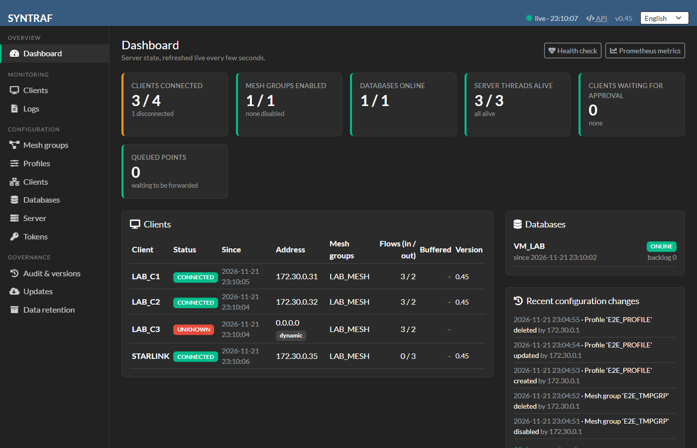
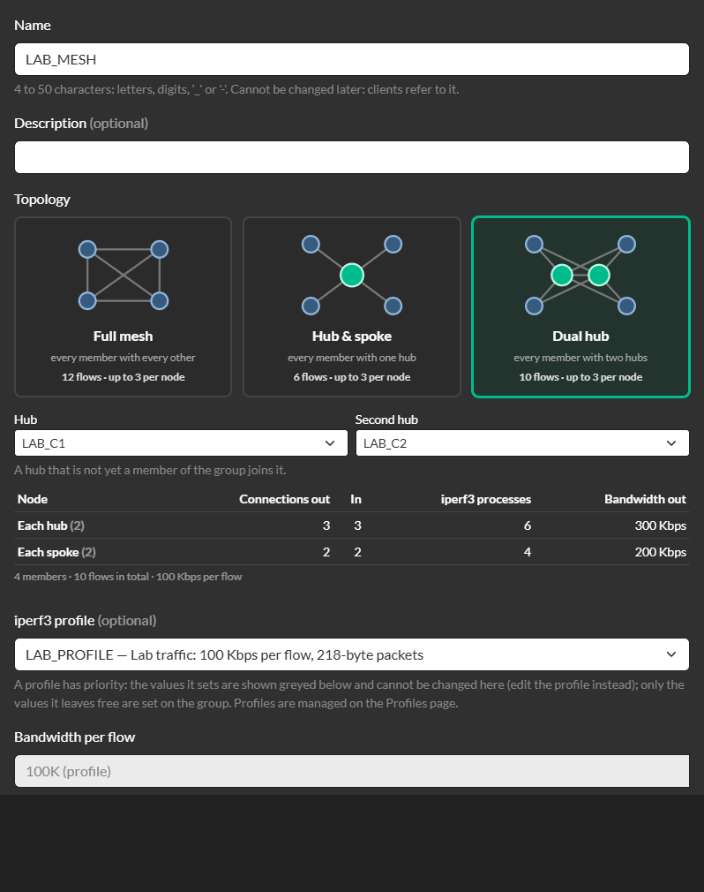
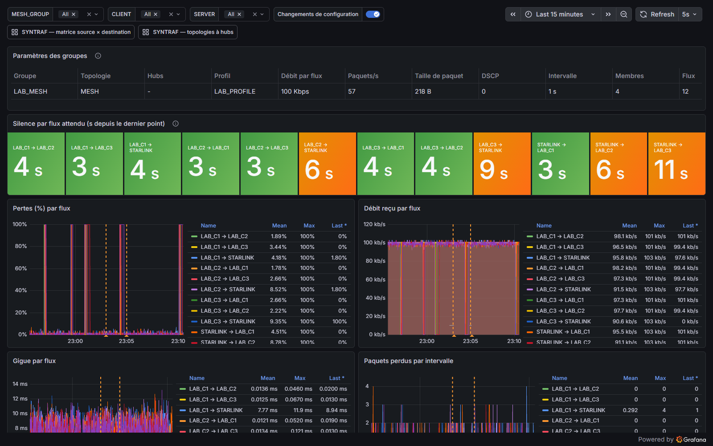

# SYNTRAF

**Synthetic traffic for network quality of experience.** SYNTRAF runs continuous, low-rate UDP flows with
[iperf3](https://github.com/esnet/iperf) between probes placed across your network, stores **loss, jitter and
throughput** for every direction of every pair in VictoriaMetrics or InfluxDB 2, and shows them in Grafana. A central
server manages the probes, their configuration and their whole lifecycle from a web interface and a REST API.

📖 **Full documentation: [`docs/html/index.html`](docs/html/index.html)** (installation, web interface, topologies,
security, NAT, logs and syslog/CEF, remote updates, configuration reference, REST API, lab, troubleshooting).

Looking for collaborators! Email me at shadow131 @ hotmail [dot] com



## Features

- **Central management, live.** Mesh groups, iperf3 profiles, clients, databases, tokens, logs, updates and data
  retention are managed from the web interface (English or French) or the API. Every change is validated, previewed
  (diff, affected clients, impact) and applied live: only the clients whose measurements change reconnect.
- **Topologies.** Full mesh, hub & spoke or dual hub, chosen by clicking a picture; the connections and bandwidth per
  node are shown before saving. **Capacity guardrails** refuse or ask confirmation for changes that would multiply
  the flows.
- **Enrollment & security.** New probes ask to join with a shared token and are approved in the interface; their key
  is pinned and each gets a token of its own and proves it holds its key. Probes pin the server key, and releases are
  signed. Sign-in, API tokens, CSRF protection, HTTPS and security headers on the web interface; certificate
  signing requests (CSR) and installation of certificates signed by your certificate authority; audited changes.
- **Clients behind a NAT or a firewall.** A probe that cannot receive connections measures both directions itself
  (`iperf3 --bidir`) and keeps its NAT mappings open. A NAT is detected automatically, and an **inbound reachability
  test** (its peers try to reach its ports) shows a firewall that blocks all or part of them.
- **Rename a probe without losing its history** (its VictoriaMetrics series are rewritten under the new name).
- **Remote updates.** The server ships its own release; probes install it beside the current one and roll back
  automatically if it does not reconnect. Deployment groups (pilot, waves) for staged updates.
- **Light probes.** The release sent to probes is the probe code only (about 100 KB, no web interface) and needs
  three Python packages: `cryptography`, `psutil` and `toml`.
- **Logs.** Probe logs are forwarded to the server, searchable in one view (node, type, level, keywords), kept by
  size and age, and can be forwarded to a SIEM over syslog (RFC 5424 or **CEF**, UDP/TCP/TLS).
- **Governance.** Audit log of every change, versions of the configuration file that can be compared and restored,
  data retention status, VictoriaMetrics snapshots and purge of orphan data.
- **Dashboards.** Grafana dashboards showing the parameters of each group, only the flows the configuration expects
  (a missing flow shows *no data*), and configuration changes as annotations. A correlation matrix of loss and jitter
  between flows points to flows that degrade together (common link or bottleneck). A voice quality score (MOS,
  ITU-T E-model) per flow for the codec of its profile, loss bursts (episodes, burst ratio, longest burst), and the
  round-trip latency between probes (TWAMP-Light), measured from behind a NAT too. A live map of the probes and
  their links, colored by loss, MOS, latency or jitter.
- **Scheduled TCP tests.** Short recurring TCP throughput tests between the probes of a mesh group (frequency,
  duration, direction, streams, window, MSS, congestion control, DSCP), one at a time across the mesh. Auto mode sizes
  the window from the measured round trip and the link capacity (bandwidth-delay product), like AMPR-NG.

| Topology choice | Grafana |
| --- | --- |
|  |  |

## How it works

```
 browser ──HTTP──▶ SYNTRAF server (web UI + API :5000, control channel TLS :6531) ──▶ VictoriaMetrics / InfluxDB 2 ──▶ Grafana
                         ▲                     ▲
                   control channel        control channel
                         │                     │
                     client A ◀── iperf3 UDP flows ──▶ client B
```

The server holds the configuration and generates, for each client, its iperf3 *listeners* (receivers) and
*connectors* (senders). The receiving side measures. Clients connect outbound to the server, receive their
configuration, run iperf3, and send back their measurements (buffered while the server is unreachable) and their logs.

## Quick start

**Offline packages** (Debian, RHEL, Alpine, Windows, macOS on Apple silicon): `python packaging/build_packages.py`
builds, for each platform, a server and a probe archive with a portable Python, the dependencies and iperf3v (the
server archive also carries VictoriaMetrics and Grafana, installed already bound together); on the
target, `sudo ./install.sh` (server) or `sudo ./install.sh --server <address> --token <token>` (probe), or
`install.cmd` on Windows, installs without Internet access and creates the service. See the documentation, section
*Installation › Offline packages*. The manual installation below is for development.

Requirements: Python 3, iperf3 ≥ 3.9 with timestamps (the
[keepalive branch](https://github.com/davidBar-On/iperf/tree/issue-812-835-control-connection-keepalive) is
recommended), VictoriaMetrics (recommended) or InfluxDB 2, Grafana, and synchronized clocks (NTP). An official
iperf3 also works (Linux packages, Windows builds): the probe then runs without the control-connection keepalive.
iperf3 authentication needs an iperf3 built with OpenSSL. Probes run on Linux, Windows and macOS.

**Server**

```
git clone https://github.com/lbsou/syntraf.git /opt/syntraf && cd /opt/syntraf
python3 -m venv venv && . venv/bin/activate && pip install -r requirements_server.txt
python syntraf.py -c /etc/syntraf/config.toml -l /var/log/syntraf
```

```toml
[GLOBAL]
IPERF3_BINARY_PATH = "DISABLE"

[SERVER]
BIND_ADDRESS = "0.0.0.0"
SERVER_PORT = "6531"
MESH_LISTENERS_PORT_RANGE = "15000-16000"
TOKEN = { site_a = "a-long-random-enrollment-token" }

[[DATABASE]]
DB_UID = "VM"
DB_ENGINE = "VictoriaMetrics"
DB_SERVER = "10.0.0.10"
DB_PORT = "8428"
DB_SERVER_USE_SSL = false
```

Open `http://server:5000`, create a mesh group (topology, bandwidth, DSCP, packet size, interval, or a profile).

**Clients**

```
pip install -r requirements_client.txt     # cryptography, psutil, toml
python syntraf.py -c /etc/syntraf/config.toml -l /var/log/syntraf
```

After the first installation, a probe can be brought to the light package by a remote update (**Updates** page): it
then runs the probe code only, without the web interface.

```toml
[CLIENT]
CLIENT_UID = "PARIS_01"
SERVER = "syntraf.example.org"
SERVER_PORT = "6531"
TOKEN = "a-long-random-enrollment-token"

[GLOBAL]
IPERF3_BINARY_PATH = "/usr/local/bin/iperf3"
```

Sign in as `admin` with the password the server wrote to `<config>.initial_admin_password` (or set
`SYNTRAF_ADMIN_PASSWORD` before the first start), change it on the **Server** page (*Access*) and enable HTTPS there.
Clients pin the server key on their first connection; to protect that one too, copy the fingerprint shown on the
Server page (*Control channel*) into `SERVER_CERT_SHA256` in their `[CLIENT]` section.

Approve each new client on the **Clients** page and choose its mesh groups. Run `syntraf.py` from the installation
directory under systemd (or a Windows service wrapper): it supervises the running release, restarts it on request
and rolls back a failed update. Open TCP 6531 (server) and TCP/UDP 15000-16000 (clients, unless behind a NAT); keep
the web interface (TCP 5000) reachable by administrators only.

## Scale

| Topology | Flows for n probes | 50 probes |
| --- | --- | --- |
| Full mesh | n(n−1) | 2 450 |
| Hub & spoke | 2(n−1) | 98 |
| Dual hub | 4n−6 | 194 |

Each flow is one iperf3 process on each side and one point per interval in the database. Example: a G.711 voice
profile (218-byte packets, 87.2 Kbps, DSCP 46) in a full mesh of 16 probes uses 16 × 15 × 87.2 Kbps ≈ 21 Mbps in
total, 1.3 Mbps out of each probe.

## Building iperf3

Linux: install `build-essential libssl-dev libtool` (Debian/Ubuntu) or `"Development Tools" openssl-devel` (RHEL),
then `./configure && make && make install && ldconfig`.

Windows (Cygwin x32, package Devel): extract the iperf sources, `sh bootstrap.sh && ./configure --with-openssl`,
replace `iprintf` by `newprintf` in the sources
(`find ./src -iname "*.[ch]" | xargs -n1 sed -i 's#iprintf#newprintf#g'`), `make && make install`, then copy
`iperf3.exe` with `cygwin1.dll`, `cygcrypto-1.1.dll`, `cyggcc_s-1.dll`, `cygstdc++-6.dll` and `cygz.dll`. ESnet does
not support iperf3 on Windows.

Check the build with `iperf3 --help`: SYNTRAF uses `--rsa-public-key-path` (iperf3 authentication: configure must
find OpenSSL, Cygwin package `libssl-devel`) and `--cntl-ka`. Cygwin's `<netinet/tcp.h>` uses `u_int16_t` without
including `<sys/types.h>`, so configure's `TCP_KEEPIDLE` check fails and `--cntl-ka` silently disappears: add
`#include <sys/types.h>` to that check in `configure.ac` and `configure`. A build with both (iperf 3.22.1, Cygwin,
shipped with `cygwin1.dll`, `cygcrypto-3.dll` and `cygz.dll`) runs SYNTRAF probes on Windows with authentication.

## Test lab

`lab/` runs a complete SYNTRAF in Docker (server, four probes including a satellite site behind a NAT,
VictoriaMetrics, Grafana) with fault injection (`labctl.py degrade | cut | flap | heal`), unit tests, Docker
scenarios and a browser end-to-end test. See [`lab/README.md`](lab/README.md).

## Versioning

Every commit increments the last digit of the version (`DefaultValues.SYNTRAF_VERSION` in `lib/st_global.py`:
0.45 → 0.45.1 → 0.45.2…) through the `.githooks/pre-commit` hook; enable it once per clone with
`git config core.hooksPath .githooks`. `python tools/bump_version.py --minor` (or `--major`) marks a notable version;
`SYNTRAF_NO_BUMP=1 git commit …` skips the increment once. Packages and probe updates carry this version.

## Known issues

- `IPERF3: ERROR - TEST AUTHORIZATION FAILED`: clock skew between nodes above the threshold (10 s by default):
  synchronize the clocks or raise *Clock skew tolerated* on the Server page (*Global*).
- `UserWarning: libuv only supports millisecond timer resolution`: harmless.
